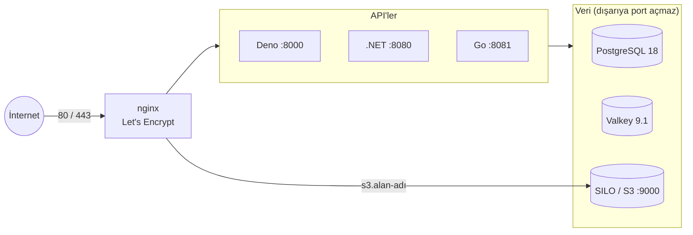

# oci-arm-stack

[](https://github.com/KULLANICI_ADI/oci-arm-stack/actions/workflows/ci.yml)
[](LICENSE)

Oracle Cloud **Always Free** ARM sunucusunu (Ampere A1, Ubuntu 26.04) tek komutla kullanıma hazırlayan kurulum betiği. Sunucuyu sertleştirir; Docker Compose ile nginx + Let's Encrypt, PostgreSQL, Valkey, S3 uyumlu nesne depolama ve Deno, .NET, Go API'lerini kurar.

```bash
curl -fsSLO https://raw.githubusercontent.com/KULLANICI_ADI/oci-arm-stack/main/setup.sh
sudo bash setup.sh example.com sen@example.com
```

## Neler kurulur

| Katman | Bileşen | Sürüm |
| --- | --- | --- |
| Reverse proxy, TLS | nginx, certbot (Let's Encrypt) | 1.30 |
| Veritabanı | PostgreSQL | 18 |
| Önbellek | Valkey (Redis uyumlu) | 9.1 |
| Nesne depolama | SILO (S3 uyumlu, MinIO fork'u) | 2026-10-26 |
| API'ler | Deno, .NET, Go | 2.9, 10, 1.27 |
| Konteynerler | Docker Engine, Docker Compose | resmi depodan güncel |

Sunucu tarafında:

- UTC saat dilimi ve otomatik güvenlik güncellemeleri (gerekirse 04:00 UTC'de yeniden başlatma)
- Yalnızca anahtarla SSH, kapalı root girişi ve fail2ban
- OCI'nin iptables kurallarında 80/443 (OCI imajlarında UFW iptables ile çakıştığı için kullanılmaz)
- 4 GB swap, BBR ve kernel ağ ayarları
- Gecelik PostgreSQL yedeği (02:30 UTC, 14 gün) ve günde iki kez sertifika yenileme

## Mimari



Dışarıya yalnızca nginx açılır. PostgreSQL ve Valkey internete çıkışı olmayan `backend` ağında çalışır; SILO konsolu yalnızca `127.0.0.1:9001`'de dinler ve SSH tüneliyle açılır.

## Gereksinimler

- **Sunucu:** Ampere A1 (`VM.Standard.A1.Flex`) ve Ubuntu 26.04 imajı. Konteyner limitleri 2 OCPU / 12 GB RAM'e göre ayarlıdır. Betik başka bir Ubuntu sürümünde ya da x86_64'te uyarı verip devam eder, ama bu ortamlar hedeflenmedi.
- **Alan adı:** Sunucunun IP'sini gösteren dört A kaydı: `deno`, `dotnet`, `go` ve `s3` (ör. `go.example.com`).
- **SSH anahtarı:** Instance oluştururken eklediğin anahtar. Anahtar bulunamazsa betik SSH ayarlarına dokunmaz.

## Kurulum

### 1. OCI konsolunu hazırla

1. Instance'ın VCN'indeki Security List'e (ya da NSG'ye) `0.0.0.0/0` kaynağından **TCP 80 ve 443** için ingress kuralı ekle. 22 numaralı portu mümkünse yalnızca kendi IP'ne aç.
2. Instance'a bir Reserved Public IP ata. Instance'ı silip yeniden oluşturursan IP'yi yenisine taşıyabilirsin.
3. DNS'te dört A kaydını bu IP'ye yönlendir.
4. İsteğe bağlı: verileri ayrı diskte tutmak için bir Block Volume oluşturup instance'a *Paravirtualized* olarak bağla ve kurulumda `DATA_DEVICE` ver ([Ayarlar](#ayarlar)).

### 2. Betiği çalıştır

```bash
ssh ubuntu@SUNUCU_IP
tmux new -s kurulum      # bağlantı koparsa kurulum yarıda kalmaz
curl -fsSLO https://raw.githubusercontent.com/KULLANICI_ADI/oci-arm-stack/main/setup.sh
less setup.sh            # root olarak çalışacak; önce göz atman önerilir
sudo bash setup.sh example.com sen@example.com
```

E-posta isteğe bağlıdır ve Let's Encrypt hesabı için kullanılır. Kurulum, indirme hızına bağlı olarak 10–20 dakika sürebilir. Bağlantın koparsa yeniden bağlanıp `tmux attach -t kurulum` ile kaldığın yere dön.

Tek satırda:

```bash
curl -fsSL https://raw.githubusercontent.com/KULLANICI_ADI/oci-arm-stack/main/setup.sh | sudo bash -s -- example.com sen@example.com
```

### 3. Kontrol et

```bash
curl -s https://go.example.com/health
# {"service":"go-api","status":"ok","time":"2026-10-29T10:00:00Z"}
```

Betiği tekrar çalıştırmak güvenlidir: var olan dosyalara ve parolalara dokunmaz, yalnızca eksik kalanları tamamlar. DNS kayıtları henüz sunucuyu göstermiyorsa sertifika adımı atlanır; kayıtlar yayılınca aynı komutu yeniden çalıştırman yeterli.

## Ayarlar

İsteğe bağlı ayarlar ortam değişkeniyle verilir:

```bash
sudo env DATA_DEVICE=/dev/sdb FORMAT_DATA_DEVICE=yes SERVER_HOSTNAME=app-01 \
  bash setup.sh example.com sen@example.com
```

| Değişken | Varsayılan | Açıklama |
| --- | --- | --- |
| `DATA_DEVICE` | | Block Volume'u `/srv`'ye bağlar (ör. `/dev/sdb`, adını `lsblk` ile bul). `/srv` boş olmalı, yani ilk kurulumda ver. |
| `FORMAT_DATA_DEVICE` | `no` | `yes` ise boş diski ext4 ile biçimlendirir. Dosya sistemi olan diski biçimlendirmez. |
| `SERVER_HOSTNAME` | | Sunucu adı |
| `ADMIN_USER` | sudo'yu çalıştıran kullanıcı | Stack dosyalarının sahibi; `docker` grubuna eklenir |
| `SSH_ALLOW_USERS` | `ADMIN_USER` | SSH ile girebilecek kullanıcılar (boşlukla ayır) |
| `SWAP_SIZE_GB` | `4` | Swap boyutu (GB) |
| `AUTO_REBOOT_TIME` | `04:00` | Güncelleme sonrası gerekirse yeniden başlatma saati (UTC) |
| `SAMPLE_APPS` | `1` | `0` ise örnek API'ler oluşturulmaz |
| `SKIP_CERT` | `0` | `1` ise sertifika adımı atlanır |
| `SKIP_DNS_CHECK` | `0` | `1` ise kayıtların bu sunucuyu gösterip göstermediği kontrol edilmez |
| `FORCE_CONFIG` | `0` | `1` ise yapılandırma dosyaları yeniden yazılır, eskileri `.bak-*` olarak saklanır. Parolalar değişmez. |
| `STACK_DIR` | `/srv/stack` | Stack klasörü |
| `LOG_FILE` | `/var/log/oci-setup.log` | Kurulum logu |

## Kurulumdan sonra

### Dosya yapısı

```
/srv/stack
├── compose.yaml
├── .env                 # PostgreSQL, Valkey ve SILO parolaları
├── backup-db.sh
├── nginx/               # nginx.conf, conf.d/, snippets/
├── certbot/             # Let's Encrypt sertifikaları
├── valkey/valkey.conf
└── apps/
    ├── deno-api/        # Dockerfile, main.ts, .env
    ├── dotnet-api/      # Dockerfile, Api.csproj, Program.cs, .env
    └── go-api/          # Dockerfile, go.mod, main.go, .env
/srv/data                # postgres/, valkey/, silo/
/srv/backups/postgres    # gecelik veritabanı yedekleri
```

### Kendi API'ni yayınla

Betik her API klasörüne `/health` uç noktası olan küçük bir örnek koyar. Kendi kodunu kullanmak için örnek dosyaları silip kodunu aynı klasöre kopyala, sonra imajı yeniden derle:

```bash
cd /srv/stack/apps/go-api
rm main.go go.mod        # örnek dosyalar; Dockerfile ve .env kalsın
# kodunu buraya kopyala (git clone, scp, rsync...)
cd /srv/stack && docker compose up -d --build go-api
```

| API | Klasör | Port | Örnek dosyalar |
| --- | --- | --- | --- |
| Deno | `apps/deno-api` | 8000 | `main.ts` |
| .NET | `apps/dotnet-api` | 8080 | `Api.csproj`, `Program.cs` |
| Go | `apps/go-api` | 8081 | `go.mod`, `main.go` |

- Uygulama tüm arayüzlerde (`0.0.0.0`) dinlemeli; nginx konteynere bu porttan ulaşır.
- .NET Dockerfile'ı `Api.dll` çalıştırır. Proje adın farklıysa `ENTRYPOINT` satırını değiştir.
- Gerçek istemci IP'si `X-Real-IP` başlığında gelir.

Bağlantı bilgileri her API'nin `.env` dosyasında hazırdır. Go için örnek:

```ini
DATABASE_URL=postgres://go_app:…@postgres:5432/go_db?pool_max_conns=25
VALKEY_URL=redis://:…@valkey:6379/0
S3_ENDPOINT=http://silo:9000
S3_PUBLIC_ENDPOINT=https://s3.example.com
S3_BUCKET=uploads
S3_ACCESS_KEY=app-user
S3_SECRET_KEY=…
```

Deno'da aynı değişkenler var. .NET'te bilgiler ASP.NET Core adlarıyla gelir: `ConnectionStrings__Default`, `ConnectionStrings__Valkey` ve `S3__Endpoint`, `S3__Bucket` gibi `S3__*` değerleri. S3 istemcisinde path-style adreslemeyi aç (`forcePathStyle: true`); tarayıcıya verilecek imzalı URL'leri `S3_PUBLIC_ENDPOINT` ile üret.

### Sık kullanılan komutlar

```bash
cd /srv/stack
docker compose ps                                  # servislerin durumu
docker compose logs -f go-api                      # canlı loglar
docker compose exec postgres psql -U postgres      # veritabanı kabuğu
systemctl list-timers certbot-renew.timer db-backup.timer   # zamanlayıcılar
```

`docker` komutlarını sudo'suz kullanmak için kurulumdan sonra oturumu kapatıp yeniden aç.

SILO konsoluna kendi bilgisayarından SSH tüneliyle bağlan, sonra tarayıcıda `http://localhost:9001` adresini aç. Kullanıcı adı ve parola `/srv/stack/.env` dosyasında (`SILO_ROOT_USER`, `SILO_ROOT_PASSWORD`).

```bash
ssh -L 9001:127.0.0.1:9001 ubuntu@SUNUCU_IP
```

### Yedekler

Veritabanları her gece 02:30'da (UTC) `/srv/backups/postgres` klasörüne yedeklenir ve 14 gün saklanır. Elle yedek almak için `sudo systemctl start db-backup` yeterli. Geri yüklemeyi ara sıra dene:

```bash
cd /srv/stack
docker compose exec -T postgres createdb -U postgres restore_test
docker compose exec -T postgres pg_restore -U postgres -d restore_test --no-owner \
  < /srv/backups/postgres/go_db_TARIH.dump
docker compose exec -T postgres dropdb -U postgres restore_test
```

Yedekler aynı sunucuda durur ve SILO'daki dosyaları kapsamaz. Sunucu dışına bir kopya (ör. rclone ile OCI Object Storage'a) ayrıca ayarlanmalı.

### Güncelleme

```bash
cd /srv/stack
docker compose --profile tools pull --ignore-buildable   # nginx, postgres, valkey, silo, certbot
docker compose build --pull                              # API imajları
docker compose up -d
```

`postgres:18`, `valkey/valkey:9.1-alpine` ve `nginx:1.30-alpine` etiketleri kendi serilerindeki son yamayı çeker. SILO etiketi sabittir; yeni sürüme geçmek için `compose.yaml`'daki etiketi değiştir ve sürüm notlarındaki yükseltme adımlarına bak. Docker Engine otomatik güncellenmez, ara sıra `sudo apt update && sudo apt upgrade` çalıştır.

### Kaldırma

```bash
cd /srv/stack && docker compose down     # konteynerleri durdurur; veriler /srv/data'da kalır
sudo systemctl disable --now certbot-renew.timer db-backup.timer
```

## Sorun giderme

**Sertifika alınamadı.** `nslookup go.example.com` sunucunun IP'sini döndürmeli ve Security List'te 80 açık olmalı. Cloudflare kullanıyorsan kayıtları *DNS only* (gri bulut) yap. Sonra betiği aynı komutla tekrar çalıştır.

**Siteye ulaşılamıyor (zaman aşımı).** Önce OCI Security List'i kontrol et. Sunucuda `sudo iptables -S INPUT` çıktısında 80 ve 443 için `ACCEPT` kuralı olmalı. Yoksa `/etc/iptables/rules.v4` dosyasında `--dport 22` satırının altına şu iki satırı ekle:

```
-A INPUT -p tcp -m state --state NEW -m tcp --dport 80 -j ACCEPT
-A INPUT -p tcp -m state --state NEW -m tcp --dport 443 -j ACCEPT
```

Sonra kuralları yükle. `iptables-restore` Docker'ın kurallarını da sildiği için Docker'ı yeniden başlatmak gerekir:

```bash
sudo iptables-restore < /etc/iptables/rules.v4 && sudo systemctl restart docker
```

**502 Bad Gateway.** nginx çalışıyor ama API yanıt vermiyor. `docker compose ps` ve `docker compose logs go-api` ile nedenine bak.

**Kurulum yarıda kaldı.** Ayrıntılar `/var/log/oci-setup.log` dosyasında. Sorunu giderip aynı komutu tekrar çalıştır.

**Yapılandırmayı baştan yazmak.** `FORCE_CONFIG=1` dosyaları yeniden üretir ve eskilerini `.bak-*` olarak saklar; parolalar değişmez.

## Güvenlik

- Parolalar kurulumda rastgele üretilir ve `/srv/stack/.env` ile `apps/*/.env` dosyalarında (izin `600`) saklanır. Bu dosyaları paylaşma ve Git'e ekleme.
- Dışarıya yalnızca 80 ve 443 açılır; PostgreSQL, Valkey ve SILO konsoluna dışarıdan erişilemez.
- `docker` grubundaki kullanıcı root yetkisine eşdeğerdir.
- Betik root olarak çalışır. Çalıştırmadan önce okuman, sabit bir sürüm için de URL'de `main` yerine sürüm etiketini (ör. `v1.0.0`) kullanman önerilir.
- Güvenlik açığı bulursan herkese açık issue yerine GitHub'daki **Security → Report a vulnerability** bölümünden bildir.

## cloud-init ile otomatik kurulum

Instance oluştururken *Show advanced options → Management → Initialization script* alanına aşağıdaki betiği yapıştırırsan sunucu ilk açılışta kendini kurar:

```bash
#!/bin/bash
curl -fsSL https://raw.githubusercontent.com/KULLANICI_ADI/oci-arm-stack/main/setup.sh -o /root/setup.sh
bash /root/setup.sh example.com sen@example.com
```

İlerlemeyi `/var/log/cloud-init-output.log` dosyasından izleyebilirsin. DNS kayıtları o sırada hazır değilse sertifika adımı atlanır; kayıtlar yayılınca `sudo bash /root/setup.sh example.com sen@example.com` ile tamamla. Security List kuralları ve DNS kayıtları yine elle ayarlanır.

## Geliştirme

Değişiklikleri bir sunucuya dokunmadan sınamak için:

```bash
shellcheck -x setup.sh tests/render-test.sh
bash tests/render-test.sh        # Docker varsa compose.yaml ve nginx yapılandırmasını da dener
```

GitHub Actions her push'ta bu kontrolleri çalıştırır, ardından örnek API'leri Ubuntu 26.04 arm64 üzerinde derleyip `/health` uç noktalarını dener. Sürüm notları [CHANGELOG.md](CHANGELOG.md) dosyasında. Issue ve pull request'ler açık.

## Lisans

[MIT](LICENSE). Bu proje Oracle ile bağlantılı değildir; adı geçen ürün ve markalar sahiplerine aittir.
